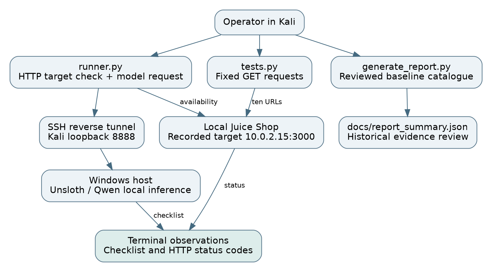

# Local LLM Security Assessment Lab

A local Qwen model supplies security guidance while Python scripts probe an authorised OWASP Juice Shop deployment. Unsloth Studio runs on a Windows host and Kali Linux reaches its API through an SSH reverse tunnel.

The repository demonstrates **local inference, target connectivity and ten HTTP endpoint probes**. The current code uses REST requests directly. MCP tool registration, adaptive execution and evidence-backed vulnerability validation are development goals.



## Demonstrated work

| Capability | Evidence | Interpretation |
|---|---|---|
| Qwen2.5-Coder-7B-Instruct GGUF selected | [Model capture](docs/screenshots/02-local-model.png) | Unsloth shows the model and quantisation |
| Juice Shop running | [Application](docs/screenshots/01-lab-scope.png) | Local browser reaches the target |
| Target and model contacted | [Runner output](docs/screenshots/05-2-MCP-EXECUTION.png) | Target returns HTTP 200; model returns a checklist |
| Ten probes attempted | [Probe output](docs/screenshots/06-security-checks.png) | Status observations, not ten confirmed vulnerabilities |
| Summary created | [Generation output](docs/screenshots/07-report-summary.png) | File creation only; the earlier completion label was not a validation result |

See the [assessment report](docs/REPORT.md) and [technical PDF](reports/technical-assessment-report.pdf) for the complete evidence review.

## Quick start

Use only a disposable authorised local lab.

```bash
git clone https://github.com/osama-git05/juice-mcp-lab.git
cd juice-mcp-lab
python3 -m venv .venv
source .venv/bin/activate
python -m pip install -r requirements.txt
IMAGE=$(cat image-reference.txt)
sudo docker pull "$IMAGE"
sudo docker run --name juice-mcp-target -d -p 127.0.0.1:3000:3000 "$IMAGE"
```

Configure Unsloth, the tunnel and private environment using the [setup guide](docs/SETUP.md), then run:

```bash
python runner.py
python tests.py
python generate_report.py
```

The first script requests a checklist. The second sends GET requests in a fixed order. The third exports a conservative review of the existing screenshot observations. These entry points do not yet implement MCP.

## Documentation

- [Setup and troubleshooting](docs/SETUP.md)
- [Architecture and data flow](docs/ARCHITECTURE.md)
- [Ten-test matrix and confirmation requirements](docs/TEST_MATRIX.md)
- [Assessment report](docs/REPORT.md)
- [Screenshots and evidence index](docs/EVIDENCE.md)
- [Completion criteria and next steps](docs/ROADMAP.md)
- [Credential handling](SECURITY.md)

## Repository contents

| Path | Purpose |
|---|---|
| `runner.py` | Target connectivity and model checklist request |
| `tests.py` | Endpoint probes and an unused model-evaluation helper |
| `generate_report.py` | Evidence-review JSON export |
| `image-reference.txt` | Recorded Juice Shop image digest |
| `requirements.txt` | Python dependency installation constraints |
| `.env.example` | Configuration template without a key |
| `docs/` | Architecture, methodology, report and screenshots |
| `reports/` | Technical PDF report |

## Results and limitations

The capture shows HTTP 200, 401, 403, 406 and 500 responses. The scripts do not persist response bodies, headers, timings or account-comparison evidence. Hash fragments are interpreted by browsers and are not sent to the server. These probes cannot establish injection, XSS, IDOR, password reset weakness, remote execution or privilege escalation.

The model response demonstrates local security guidance. Measuring adaptive testing or vulnerability detection requires more evidence.

## Credential hygiene

An earlier revision contained an API key in a tracked environment file and a screenshot. Revoke it before further use. The revised tree removes both exposures and ignores local secrets. Old Git objects still contain them. See [SECURITY.md](SECURITY.md).
