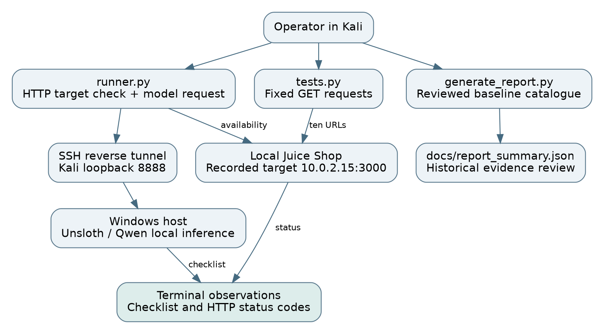
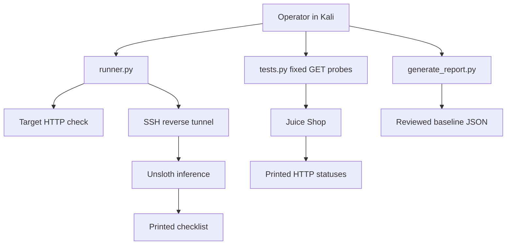
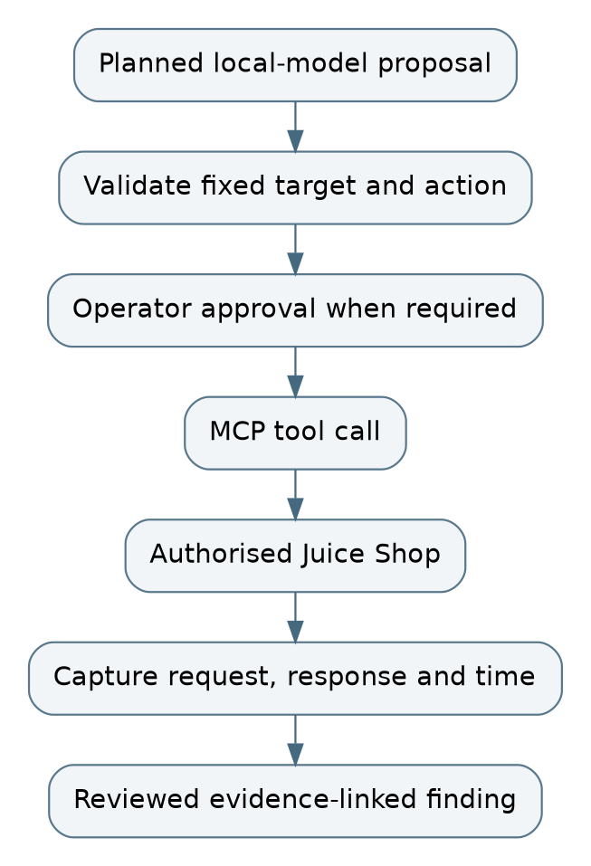
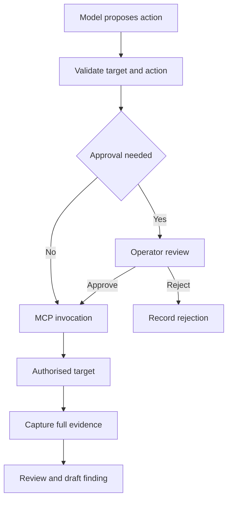

# Architecture

## Implemented data flow

The current source uses direct HTTP calls through Requests. The model returns a checklist. The probe loop does not use that response to choose its next action.

There is no FastAPI application, MCP client/server, retrieval index, tool-calling loop, hardcoded target allowlist or approval interceptor in the reviewed source.

## Network roles

| Endpoint | Role |
|---|---|
| Windows loopback 8888 | Model listener |
| Kali loopback 8888 | Reverse-forwarded model API |
| Windows loopback 2222, if configured | NAT forwarding to Kali SSH 22 |
| Kali loopback 3000 | Recommended local application binding |
| 10.0.2.15:3000 | Address printed in the recorded runner and probe evidence |

The screenshots demonstrate a working inference response but do not independently establish all adapter or SSH settings.

## Planned MCP increment

Start with one fixed check, preserve its full result and show a real MCP tools/list and tools/call exchange. Add adaptive selection after that path is demonstrated. Editable draw.io files, Graphviz sources and PNG exports are in docs/architecture. Open either .drawio file in diagrams.net to edit it.
