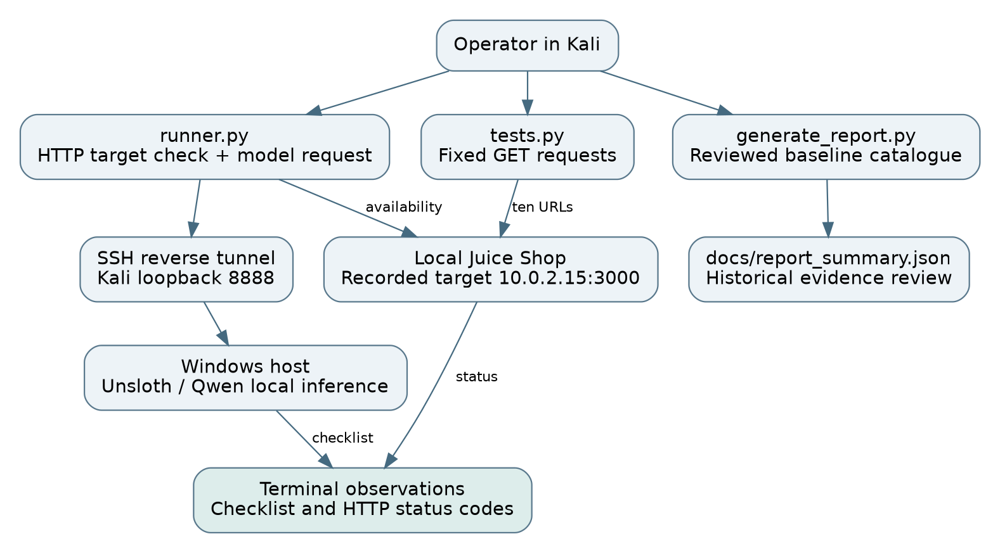
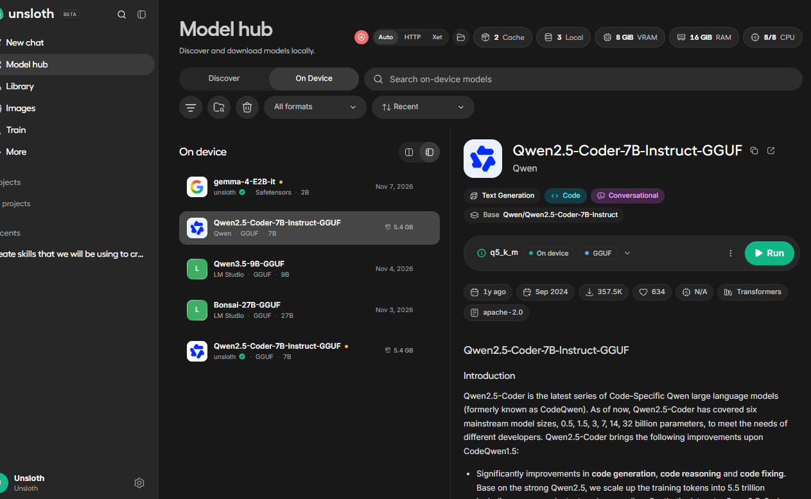
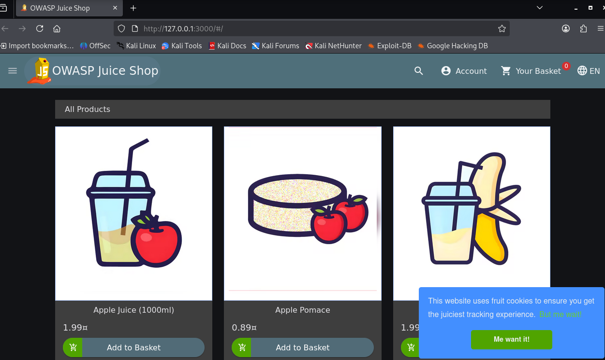
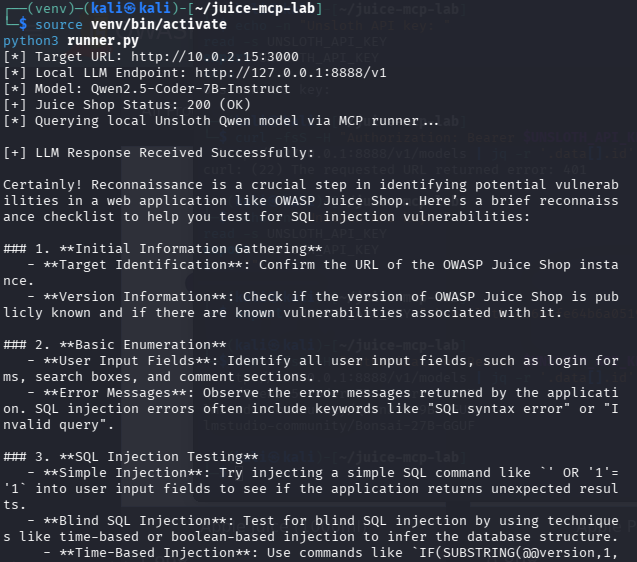
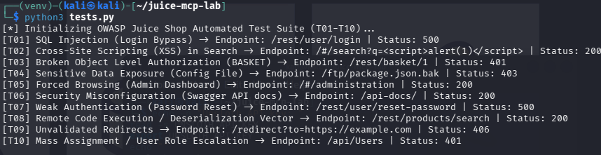

# Technical assessment and evidence review

## Executive summary

The project demonstrates a Windows-hosted Unsloth Qwen model supplying a reconnaissance checklist to a Python client in Kali. A second script probes ten OWASP Juice Shop URLs and prints HTTP response codes. Existing screenshots show a running target, model selection, a successful checklist response and the probe output.

The reviewed source does not implement MCP, FastAPI, RAG, adaptive tool dispatch or exploit verification. The earlier report marked all ten cases Verified Vulnerable without supporting request/response evidence. This revision corrects those claims. **No confirmed vulnerability is established by the committed evidence.** That statement concerns the evidence, not the intentionally vulnerable application's actual security.

## Scope and provenance

| Field | Recorded value or limitation |
|---|---|
| Reviewed source revision | b892b45beb5e54215cec0eac2a2729e2a1552504 |
| Review date | 7 November 2026 |
| Target in runner screenshot | http://10.0.2.15:3000 |
| Target in browser screenshot | http://127.0.0.1:3000 |
| Model shown | Qwen2.5-Coder-7B-Instruct GGUF, Q5_K_M selection |
| Local API in runner screenshot | http://127.0.0.1:8888/v1 |
| Target image | See image-reference.txt for the committed digest |
| Execution dates and durations | Not preserved as trustworthy machine-readable records |
| Review method | Static source review and inspection of committed screenshots |
| New live scans | None during this documentation review |

## Implemented architecture

runner.py uses Requests to contact the target, then asks the local model for a checklist. tests.py sends ten GET requests in a fixed loop. Its model-evaluation helper is unused. The original generate_report.py constructs a completion summary from a hardcoded catalogue instead of execution evidence. The revised exporter makes its baseline provenance explicit and marks all vulnerability conclusions unverified.

## Evidence figures

### Figure 1 Model selection

This shows the chosen model in Unsloth. It does not establish inference accuracy, effective memory use or all runtime settings.

### Figure 2 Target application

This shows Juice Shop reachable in a local browser. It does not prove a vulnerability.

### Figure 3 Target and model response

The terminal shows target HTTP 200 and a generated reconnaissance checklist. Despite the script's MCP label, the source performs direct REST calls.

### Figure 4 Endpoint probe observations

These are the observations evaluated in the test matrix. Status codes alone cannot confirm the named vulnerability classes.

## Results

| Category | Result |
|---|---|
| Target connectivity | Demonstrated in screenshot |
| Local model guidance | Demonstrated in screenshot |
| Endpoint probes | Ten displayed status observations |
| Confirmed vulnerabilities | Zero established from available evidence |
| Vulnerability cases awaiting validation | Ten |
| Adaptive model execution | Not implemented |
| MCP protocol exchange | Not implemented |
| Remediation and retest | No evidence committed |

See [TEST_MATRIX.md](TEST_MATRIX.md) for the status and confirmation threshold of every ID.

## Technical findings about the assessment process

### F01 Unsupported vulnerability conclusions

The original report assigned a positive finding to every catalogue entry. Neither script saves evidence capable of supporting those conclusions. Replace categorical claims with the observed request and outcome, and promote a case only after its confirmation threshold is met.

### F02 Client routes and HTTP methods are mismatched

Fragment routes such as /#/administration are not sent to the server. GET probes to login and reset workflows do not exercise their intended state-changing methods. Validate browser behaviour and use the correct API method only within the authorised lab.

### F03 Model planning is not connected to execution

The model checklist is printed to the terminal. No source connects its response to tool dispatch. Demonstrate a bounded MCP invocation and subsequent action-selection trace before describing autonomous pentesting.

### F04 Published credential exposure

The reviewed tree contained a key in .env and a screenshot. Both are removed in this documentation patch. Revoke the old key, replace it privately and address history with the owner. See [SECURITY.md](../SECURITY.md).

## Recommendations and next milestone

Preserve the working local-inference setup. Add one scoped MCP tool and save an actual protocol and execution record. Record full request/response evidence for each lab case, add browser and identity controls where needed, then let the model draft entries that a reviewer checks. Use an evidence-driven exporter so generating a file cannot silently assert testing completion.

## Verification of this documentation change

The documentation review validates internal links, source syntax, generated JSON, screenshot references and consistency between implemented capabilities and written claims. It does not rerun the target or model. Actual runtime behaviour remains to be measured in the lab.
